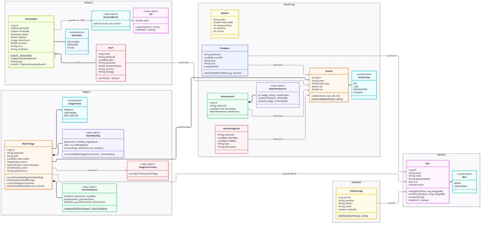
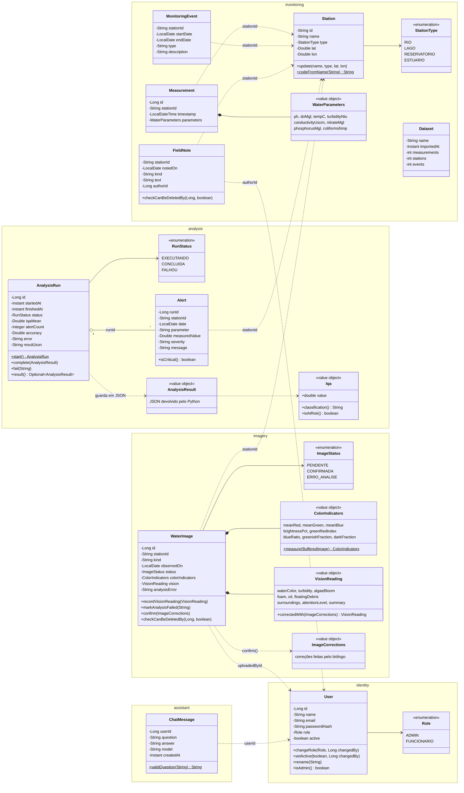
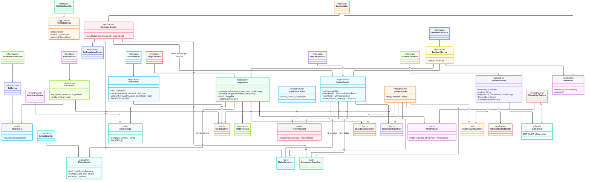
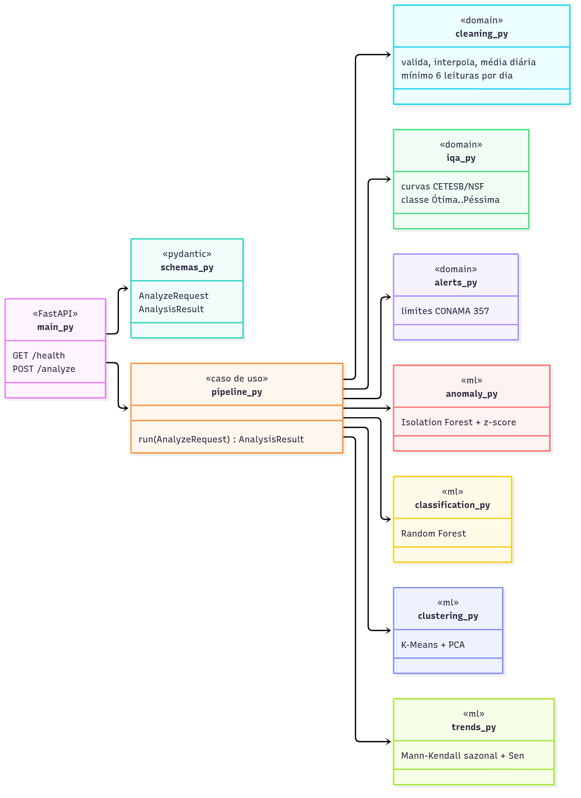
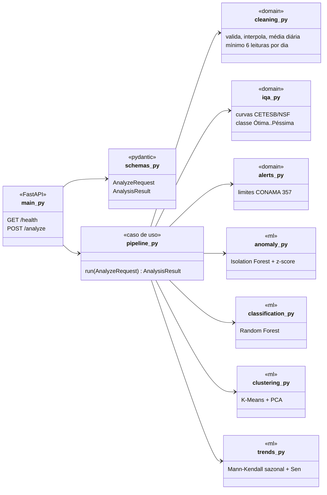

# AquaML — Diagrama de classes (backend Java Spring, DDD)

Gerado a partir do código real em `backend/src/main/java/br/forum/aquaml`. As imagens renderizadas
estão em `docs/img/`.

## Como ler

- Cada **contexto** (bounded context) é um pacote: `identity`, `monitoring`, `analysis`, `imagery`,
  `assistant` e `dashboard`. O pacote `shared` guarda o que todos usam (erros, segurança, cliente do Ollama).
- Dentro de cada contexto há quatro camadas:
  - `domain`: entidades com as regras (ex.: `WaterImage.confirm`), objetos de valor (`ColorIndicators`) e
    interfaces de repositório e de serviços externos (as **portas**);
  - `application`: os casos de uso (`AnalysisService.run()`);
  - `infrastructure`: implementações das portas (JPA, HTTP para o Python, Ollama, disco);
  - `interfaces`: os controllers REST e os DTOs de resposta.
- Os contextos se referem uns aos outros **pelo id** (ex.: `stationId`), não por objeto. Assim cada
  contexto continua independente.

## 1. Visão geral: o domínio

## 2. Camadas DDD: casos de uso, portas e adaptadores

As interfaces marcadas como `<<port>>` ficam no `domain` (ou no `application`). As classes de
`infrastructure` implementam essas interfaces. Assim o domínio não depende do Spring, do JPA nem do HTTP.

```mermaid
classDiagram
    direction TB

    class AuthController { <<interfaces>> }
    class UserController { <<interfaces>> }
    class DataController { <<interfaces>> }
    class StationController { <<interfaces>> }
    class FieldNoteController { <<interfaces>> }
    class AnalysisController { <<interfaces>> }
    class ImageController { <<interfaces>> }
    class AssistantController { <<interfaces>> }
    class DashboardController { <<interfaces>> }

    class AuthService {
        <<application>>
        +login(email, password) LoginResult
        +me(CurrentUser) User
    }
    class UserService {
        <<application>>
        +list() List~User~
        +create(name, email, password, role) User
        +update(id, role, active, name, CurrentUser) User
        +delete(id, CurrentUser)
    }
    class DataImportService {
        <<application>>
        +importData(ImportCommand) ImportResult
    }
    class DataService {
        <<application>>
        +summary() DataSummary
        +deleteAll()
    }
    class StationService {
        <<application>>
        +list() List~StationOverview~
        +create(id, name, type, lat, lon)
        +series(id) JsonNode
    }
    class FieldNoteService {
        <<application>>
        +list(stationId)
        +create(...) FieldNote
        +delete(id, CurrentUser)
    }
    class AnalysisService {
        <<application>>
        +run() AnalysisRun
        +latestResult() Optional~AnalysisResult~
        +recentRuns() List~AnalysisRun~
        +alerts(stationId, severity) List~Alert~
    }
    class ImageService {
        <<application>>
        +upload(UploadCommand, CurrentUser) WaterImage
        +confirm(id, ImageCorrections) WaterImage
        +file(id) ImageFile
        +delete(id, CurrentUser)
    }
    class AssistantService {
        <<application>>
        +isAvailable() boolean
        +model() String
        +ask(question, CurrentUser) ChatMessage
        +history(CurrentUser)
        +clearHistory(CurrentUser)
    }
    class AssistantContextBuilder { <<application>> }
    class DashboardService {
        <<application>>
        +build() Dashboard
    }
    class CsvSpreadsheetParser { <<application>> }
    class PhotoProcessor { <<application>> }

    class TokenIssuer {
        <<port>>
        +issue(User) IssuedToken
    }
    class MlServiceClient {
        <<port>>
        +analyze(AnalysisInput) AnalysisResult
    }
    class VisionAnalyzer {
        <<port>>
        +read(byte[] jpeg, String kind) VisionReading
    }
    class ImageStorage {
        <<port>>
        +store(byte[], String) String
        +delete(String)
    }
    class UserRepository { <<port>> }
    class StationRepository { <<port>> }
    class MeasurementRepository { <<port>> }
    class AnalysisRunRepository { <<port>> }
    class WaterImageRepository { <<port>> }
    class ChatMessageRepository { <<port>> }

    class JwtService { <<infrastructure>> }
    class JwtAuthenticationFilter { <<infrastructure>> }
    class HttpMlServiceClient {
        <<infrastructure>>
        POST ML_SERVICE_URL/analyze
    }
    class OllamaVisionAnalyzer { <<infrastructure>> }
    class LocalImageStorage { <<infrastructure>> }
    class OllamaClient {
        <<shared>>
        POST OLLAMA_URL/api/chat
    }
    class JpaRepositories {
        <<infrastructure>>
        Spring Data gera o código
    }

    AuthController --> AuthService
    UserController --> UserService
    DataController --> DataImportService
    DataController --> DataService
    StationController --> StationService
    FieldNoteController --> FieldNoteService
    AnalysisController --> AnalysisService
    ImageController --> ImageService
    AssistantController --> AssistantService
    DashboardController --> DashboardService

    AuthService --> UserRepository
    AuthService --> TokenIssuer
    UserService --> UserRepository
    DataImportService --> CsvSpreadsheetParser
    DataImportService --> StationRepository
    DataImportService --> MeasurementRepository
    DataImportService --> AnalysisService : roda a análise após importar
    AnalysisService --> MlServiceClient
    AnalysisService --> AnalysisRunRepository
    AnalysisService --> StationRepository : lê os dados
    AnalysisService --> MeasurementRepository : lê os dados
    ImageService --> PhotoProcessor
    ImageService --> VisionAnalyzer
    ImageService --> ImageStorage
    ImageService --> WaterImageRepository
    ImageService --> StationService : cria ponto novo
    AssistantService --> AssistantContextBuilder
    AssistantService --> OllamaClient
    AssistantService --> ChatMessageRepository
    DashboardService --> AnalysisService
    DashboardService --> DataService
    DashboardService --> ImageService

    JwtService ..|> TokenIssuer
    HttpMlServiceClient ..|> MlServiceClient
    OllamaVisionAnalyzer ..|> VisionAnalyzer
    OllamaVisionAnalyzer --> OllamaClient
    LocalImageStorage ..|> ImageStorage
    JpaRepositories ..|> UserRepository
    JpaRepositories ..|> StationRepository
    JpaRepositories ..|> MeasurementRepository
    JpaRepositories ..|> AnalysisRunRepository
    JpaRepositories ..|> WaterImageRepository
    JpaRepositories ..|> ChatMessageRepository
    JwtAuthenticationFilter --> JwtService
```

`JpaRepositories` resume os adaptadores `JpaUserRepository`, `JpaStationRepository` etc. Cada um é só
`interface JpaXRepository extends Repository<X, Id>, XRepository`.

## 3. Serviço ML (Python) — módulos

